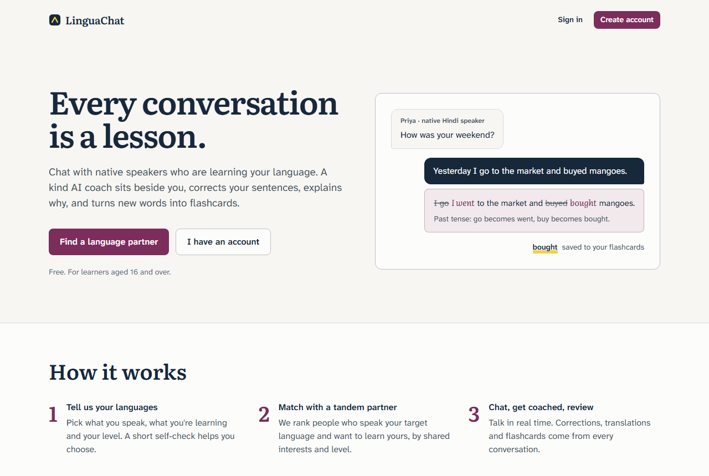
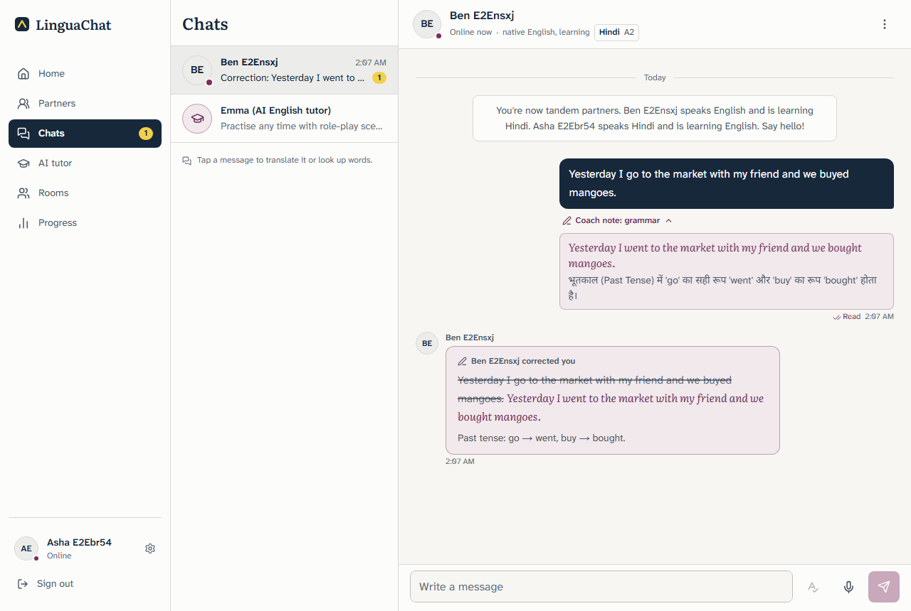
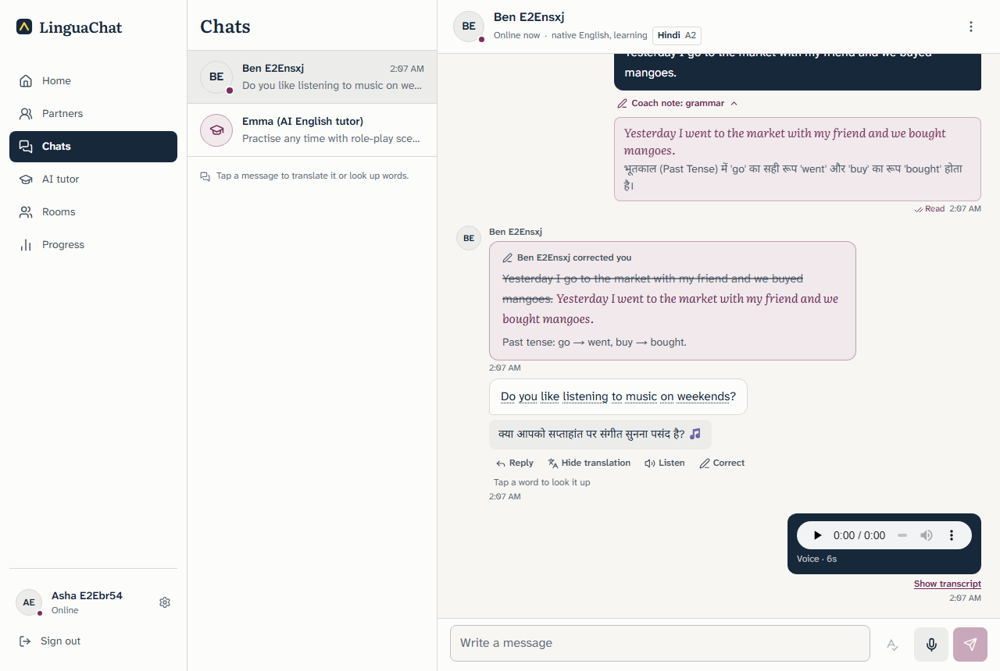
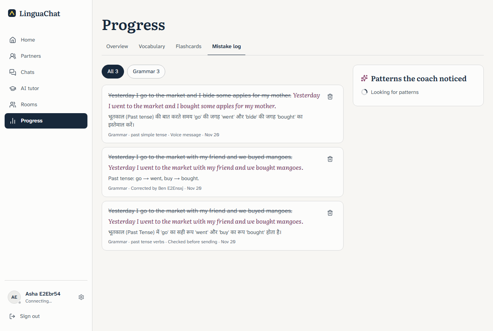

# LinguaChat

**Learn a language by chatting with real native speakers, with a kind AI coach beside you.**

LinguaChat pairs you with a tandem partner: someone who speaks the language you're learning and
wants to learn yours. While you chat in real time, an AI coach quietly corrects your sentences,
explains why, translates what you don't understand, and turns new words into flashcards. When no
partner is online, an AI tutor role-plays everyday scenes with you.

**Live app:** https://linguachat-chi.vercel.app



## Features

- **Onboarding**: native languages, target language with a CEFR self-check (A1–C2), interests,
  goals and a daily practice goal. 12 languages: English, Hindi, Spanish, French, German,
  Portuguese, Italian, Russian, Japanese, Korean, Mandarin, Arabic. 16+ only.
- **Find partners**: tandem matching with a compatibility score (tandem fit, shared interests,
  level balance, goals, online now), filters, profiles, chat requests that arrive instantly,
  accept/decline, block and report.
- **Coached chat**: check before sending, AI coach notes attached to sent messages, partner
  correction cards, tap-to-translate, tap-a-word for meaning + example + pronunciation, save to
  vocabulary, share vocab cards, HD voice messages with AI transcripts and corrections, replies,
  typing indicators, read receipts, unread counts.
- **AI tutor**: café, job interview, travel, doctor, small talk or your own scene. Replies stream
  in, adapt to your level, corrections attach to your messages, "Help me reply" suggests phrases.
- **Practice rooms**: group chats per language, level band and topic with a new AI-written
  conversation prompt every day, member list and who's online.
- **Progress**: streaks, daily goal, weekly chart and stats, vocabulary notebook with SM-2
  spaced-repetition flashcards, mistake log grouped by type with AI-found patterns.

| Coached chat | Partner correction card |
| --- | --- |
|  |  |
| **Translation, word lookup, voice** | **AI tutor** |
|  |  |
| **Find partners** | **Mistake log** |
|  |  |

More in [`docs/screenshots`](docs/screenshots).

## How this uses Nexconn

LinguaChat is built directly on the **Nexconn Web Chat SDK** (custom UI) plus the **Platform Chat
API** from our server (Singapore data center). No console webhooks: the browser calls our API
after an SDK action and the server acts through the Platform API.

| Nexconn feature | How LinguaChat uses it |
| --- | --- |
| User registration + access tokens (Platform API) | Every learner and bot gets a prefixed Nexconn id; tokens are issued by `/api/nexconn/token` and refreshed automatically on error 31004. |
| Connection lifecycle | Single SDK connection with status handling, auto-reconnect banner, "signed in elsewhere" (31010) handling. |
| **Direct channels** | 1:1 tandem chats and the AI tutor conversation. |
| **Group channels** | Practice rooms; groups created and members added by the server. |
| **Custom message types** | `LGC:Correction` (correction cards), `LGC:VocabCard` (shared words), `LGC:TutorTip` (scene and hint cards), `LGC:RoomPrompt` (daily prompts), `LGC:Notice` (partner welcome). |
| Status messages | `LGC:Signal` (not stored, not counted) refreshes chat requests instantly and hands tutor streams to the client. |
| **Message metadata** | AI corrections (`aic`) and voice transcripts (`vtx`) are attached to the original message by the server; both people see them update live. |
| Reply / quote | `RC:ReferenceMsg` replies with a quoted snippet. |
| **HD voice messages** | Recorded in the browser, uploaded through the SDK as `RC:HQVCMsg`, transcribed by Gemini. |
| **Streaming messages** | The tutor bot's replies are streamed as `RC:StreamMsg` chunks from the server; the client requests the stream and renders it as it grows. |
| Server-sent bot messages | Tutor bot, room host bot (daily prompts) and system notices via the Platform API. |
| Read receipts | "Read" under your last read message (direct chats). |
| Typing indicators | "… is typing" in direct chats. |
| Unread counts + channel list | Nav badge and per-conversation unread counts; unread cleared when you read. |
| History pagination | Older messages load as you scroll up. |
| **Presence** | Online-status subscriptions power "Online now", the compatibility bonus, "online now" filter and room online counts. |
| **User blocking** | Blocking adds the user to the Nexconn blocklist (and hides them in the app). |
| User profile update | Name/photo changes sync to Nexconn. |

Exact code locations are listed in [AGENTS.md](AGENTS.md#nexconn-features-used-and-where).

## Tech stack

Next.js 16 (App Router, TypeScript strict) · Tailwind CSS 4 · Nexconn Web Chat SDK + Platform
Chat API · Gemini (`@google/genai`, structured JSON output, streaming, audio understanding) ·
Neon Postgres + Drizzle ORM · Vercel (functions in `sin1`) + Vercel Blob · zod · jose + bcrypt ·
SWR · lucide icons · Vitest + Playwright.

## Setup

```bash
npm install
vercel link && vercel env pull .env.local --yes   # or create .env.local (names in AGENTS.md)
npm run db:migrate
npm run dev                                       # http://localhost:3103
```

Checks: `npm run typecheck`, `npm run lint`, `npm test` (unit), `npm run e2e` (Playwright, real
services; set `E2E_BASE_URL` to test a deployment). Deploy: `vercel deploy --prod`.

## Testing

- 12 unit tests (SM-2 scheduling, compatibility scoring, streaks, CEFR self-check, rooms, time zones).
- 10-step Playwright journey with two browser contexts (a Hindi speaker learning English and an
  English speaker learning Hindi) against real Neon, Nexconn and Gemini: onboarding, matching,
  request/accept, real-time chat, check before sending, AI coach notes, typing and read receipts,
  correction card, translation and word saving, HD voice with transcript, flashcard review,
  AI tutor, practice room, progress and blocking. Passing locally and against production.
