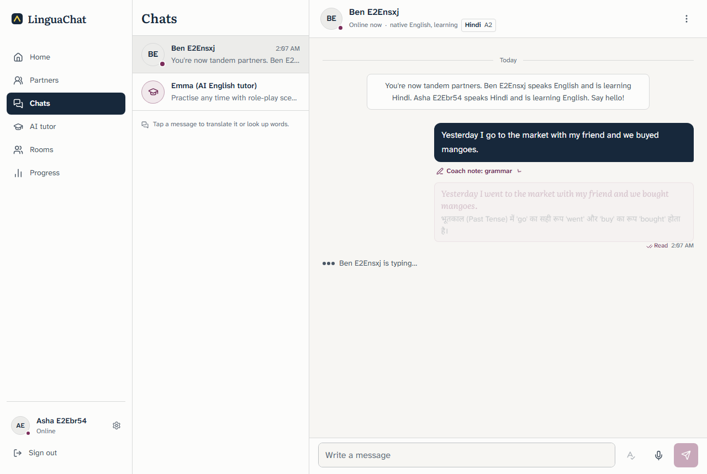
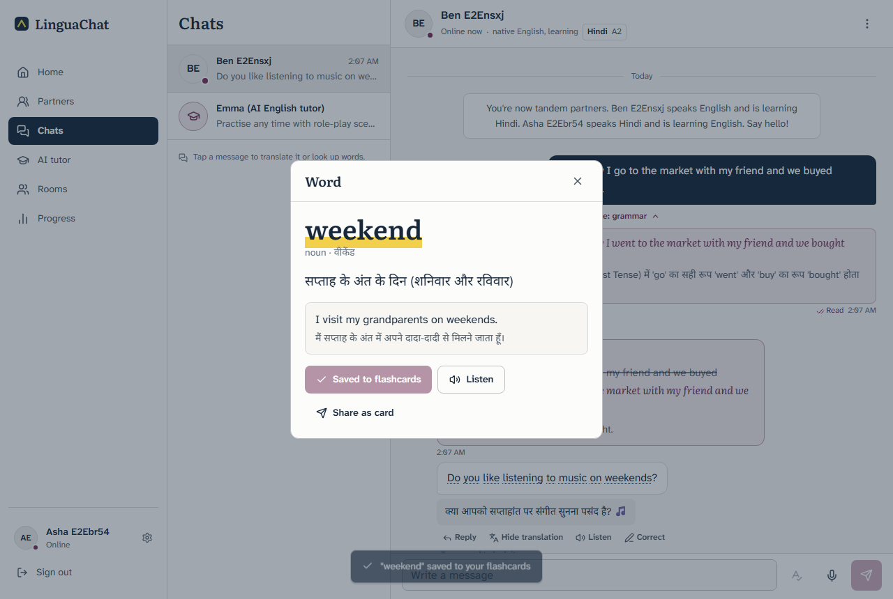
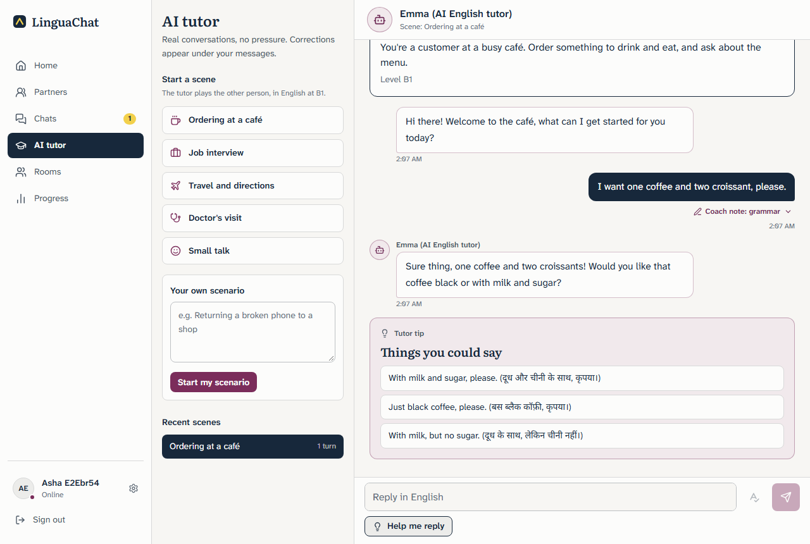
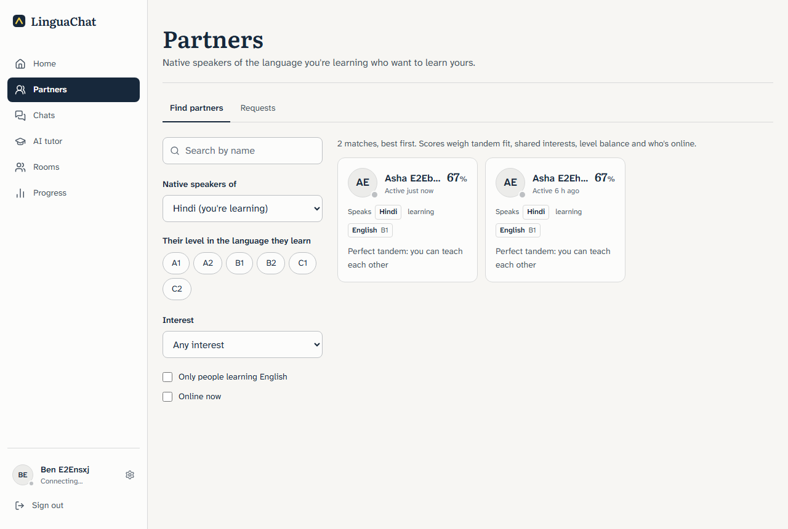
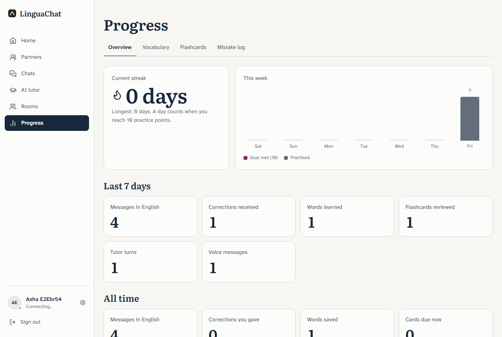
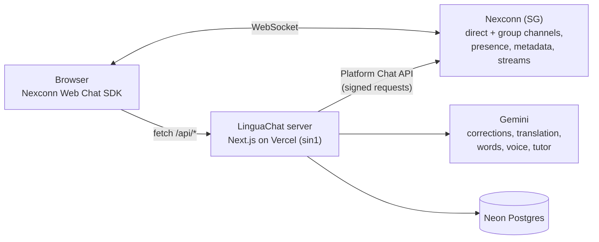

<p align="center">
  
</p>

<h1 align="center">LinguaChat</h1>

<p align="center">
  <strong>Learn a language from the people who speak it.</strong><br>
  Real-time tandem chat with native speakers, and a kind AI coach beside every conversation.
</p>

<p align="center">
  <a href="https://linguachat-chi.vercel.app"><strong>Open the live app</strong></a> ·
  <a href="#how-linguachat-uses-nexconn">How it uses Nexconn</a> ·
  <a href="#run-it-locally">Run it locally</a>
</p>


## What it is

Textbooks teach you a language; people teach you how it's actually spoken. LinguaChat pairs you with a
**tandem partner**: someone who speaks the language you're learning and wants to learn yours. You chat
in real time, and an AI coach sits quietly beside the conversation:

- it **corrects your sentences** and explains why, in your own language, without interrupting;
- it **translates** anything you don't understand and **explains any word** you tap;
- it **transcribes voice messages** and corrects what you said;
- it turns new words into **spaced-repetition flashcards** and finds **patterns in your mistakes**.

When nobody is online, an **AI tutor** role-plays everyday scenes with you, and **practice rooms** give
each language and level a group chat with a fresh conversation prompt every day.

Built for the **Nexconn Build Challenge 2026**. Twelve languages, any direction: English, Hindi,
Spanish, French, German, Portuguese, Italian, Russian, Japanese, Korean, Mandarin and Arabic.

## Features

| | |
| --- | --- |
| **Onboarding** | Native languages, the language you learn, a CEFR self-check (can-do statements) or a manual A1–C2 pick, interests, goals, a daily practice goal. 16+ only. |
| **Find a partner** | Native speakers of your target language ranked by a compatibility score: tandem fit, shared interests, level balance, goals, and +10 when they're online right now. Filters, profiles, chat requests that arrive instantly, accept / decline, block and report. |
| **Coached chat** | Check a sentence before sending; a coach note on every message you send; partner correction cards; translate any message; tap a word for meaning, reading, example and pronunciation; save words; share vocabulary cards; HD voice messages with transcripts; replies; typing indicators; read receipts; unread counts. |
| **AI tutor** | Café, job interview, travel, doctor, small talk or your own scene. Replies stream in, adapt to your level, correct you as you go, and "Help me reply" suggests phrases when you're stuck. |
| **Practice rooms** | 12 group chats per language (3 level bands × 4 topics), a new AI-written prompt every day posted by the room host bot, members list with live presence. Rooms in your native languages appear so you can help learners. |
| **Progress** | Daily goal ring, streaks, a 7-day chart, weekly and all-time stats, a vocabulary notebook, SM-2 flashcard review (keys 1–4), and a mistake log grouped by type with AI-found patterns ("You often …"). |

| Coached chat | Partner correction card |
| --- | --- |
|  |  |
| **Word lookup** | **AI tutor** |
|  |  |
| **Find partners** | **Progress** |
|  |  |

More in [`docs/screenshots`](docs/screenshots).

## How LinguaChat uses Nexconn

LinguaChat is built directly on the **Nexconn Web Chat SDK** (`@nexconn/chat`, with our own UI) in the
browser and the **Nexconn Platform Chat API** on the server, in the Singapore data center. There are no
console webhooks: after an SDK action the browser calls our API, and the server verifies membership or
partnership before acting through the Platform Chat API.



### Every Nexconn feature in the app

| Nexconn feature | What it does in LinguaChat | Code |
| --- | --- | --- |
| User registration + access tokens | Every learner and bot gets a prefixed Nexconn id; the server issues tokens and the client refreshes them on error 31004. | `lib/nexconn/server.ts#issueToken`, `api/nexconn/token` |
| Connection lifecycle | One SDK connection with status handling, auto-reconnect banner, and "signed in elsewhere" (31010) with "Reconnect here". | `lib/nexconn/client.ts`, `components/app/shell.tsx` |
| **Direct channels** | 1:1 tandem chats and the AI tutor conversation. | `client.ts#channel`, `components/chat/thread.tsx` |
| **Group channels** | Practice rooms: groups created by the server, members added on join, removed on leave. | `server.ts#createGroup/joinGroup/quitGroup`, `lib/server/rooms.ts` |
| **Custom message types** | `LGC:Correction` (correction card), `LGC:VocabCard` (shared word), `LGC:TutorTip` (scene + hint), `LGC:RoomPrompt` (daily prompt), `LGC:Notice` (partner welcome). | registered in `client.ts#boot`, rendered in `chat/message-item.tsx` |
| **Status messages** | `LGC:Signal` (not stored, not counted) refreshes chat requests instantly and hands tutor streams to the client. | `lib/server/social.ts#sendSignal`, `lib/server/tutor.ts` |
| **Message metadata** | Messages are sent with metadata enabled; the server attaches the AI correction (`aic`) and voice transcript (`vtx`) and both people see the note appear live via `onMessageMetadataUpdated`. | `client.ts#deliver`, `server.ts#setMessageMetadata`, `api/ai/annotate`, `api/ai/voice` |
| **Streaming messages** | The tutor bot's replies are sent as `RC:StreamMsg` chunks from the server; the client requests the stream and renders it as it grows. | `server.ts#streamDirectChunk`, `lib/server/tutor.ts`, `client.ts#requestStream` |
| **HD voice messages** | Recorded in the browser as 16 kHz WAV and sent as `RC:HQVCMsg` through the SDK's media upload. | `client.ts#sendVoice`, `lib/client/recorder.ts` |
| Reply / quote | `RC:ReferenceMsg` replies with a quoted snippet. | `client.ts#sendText` |
| Server-sent bot messages | The tutor bot, the room host bot (daily prompts) and the "you're now partners" notice post through the Platform Chat API. | `lib/server/tutor.ts`, `lib/server/rooms.ts`, `api/requests/[id]` |
| Read receipts | "Read" under your last read message in direct chats. | `client.ts#markRead/readState` |
| Typing indicators | "Sam is typing…" in direct chats. | `client.ts#sendTyping` |
| Unread counts + channel list | Nav badge, per-conversation unread counts, cleared when you read. | `client.ts#listChannels/refreshUnread` |
| History pagination | Older messages load as you scroll up. | `client.ts#createHistory` |
| **Online presence** | Online-status subscriptions power "Online now", the compatibility bonus, the "online now" filter and room online counts. | `client.ts#watchPresence`, `providers.tsx#usePresence` |
| **User blocklist** | Blocking adds the user to the Nexconn blocklist, so their messages stop at the network, and hides them in the app. | `server.ts#addToBlocklist`, `api/blocks` |
| User profile update | Name and photo changes sync to Nexconn. | `server.ts#updateUserInfo` |

### What happens when you send a message

1. The browser sends the text through the Web Chat SDK with **metadata enabled** and a read-receipt request.
2. Your partner receives it over the Nexconn WebSocket instantly; their client sends typing and read receipts back.
3. Your browser calls `POST /api/ai/annotate` with the message id. The server checks you're partners,
   asks Gemini for a correction, and calls the Platform Chat API's **set message metadata** endpoint.
4. Nexconn pushes `onMessageMetadataUpdated` to both people, so the coach note appears under the message
   on both screens. The mistake is saved to your log, and the message counts towards your daily goal.

### Switching Nexconn apps safely

Tokens and room groups record the App Key they were created in. When the key changes (as it did when this
project moved to a new Nexconn app), the next token request reissues the learner's token and copies their
blocks into the new app's blocklist, and rooms recreate their group and add their members back. A room
join that hits "group does not exist" (25410) re-provisions the group once and retries.

### Known Nexconn quirks we work around

- Server-sent `RC:StreamMsg` messages aren't pushed live to web clients, so the server also sends an
  `LGC:Signal` with the message id and the client pulls the stream (`requestStreamMessage`).
- Typing status only works in direct channels, so rooms don't show "is typing".
- Group channels only show messages sent after you joined; the daily prompt is also pinned in the UI from
  the database so late joiners see it.

## Design

The visual identity is **airmail**: a tandem exchange is the modern pen-pal letter. Postal navy ink on
airmail-tissue paper, airmail blue for actions and the coach's corrections, airmail red for mistakes, and
stamp marigold for saved words, streaks and unread counts. The envelope stripe appears in exactly two
places: around the live demo on the landing page and around the closing invitation.

- **Type**: Bricolage Grotesque for headlines, Atkinson Hyperlegible Next for the interface (designed for
  legibility, which matters when you're reading a language you're still learning), and Literata italic
  for the coach's corrections and target-language words.
- **Logo**: two speech bubbles, one for each partner, overlapping where the conversation happens.
  `node scripts/icons.mjs` renders the favicon, app icons and manifest icons from the same paths in
  `src/lib/brand.ts`.
- **Motion**: the landing hero plays a real correction (a strike drawn across the mistake, the fix written
  in, the word saved) across three language pairs; everything respects `prefers-reduced-motion`.

## Tech stack

Next.js 16 (App Router, TypeScript strict) · Tailwind CSS 4 · Nexconn Web Chat SDK + Platform Chat API ·
Gemini via `@google/genai` (structured JSON output, streaming, audio understanding) · Neon Postgres +
Drizzle ORM · Vercel (functions in `sin1`) + Vercel Blob · zod · jose + bcrypt · SWR · lucide icons ·
Vitest + Playwright.

## Run it locally

```bash
npm install
vercel link && vercel env pull .env.local --yes   # or create .env.local with the variables below
npm run db:migrate
npm run dev                                       # http://localhost:3103
```

Environment variables: `DATABASE_URL`, `DATABASE_URL_UNPOOLED`, `BLOB_READ_WRITE_TOKEN`,
`NEXCONN_APP_KEY`, `NEXCONN_APP_SECRET`, `NEXCONN_API_BASE` (`https://api.sg-light-api.com`),
`NEXCONN_ID_PREFIX`, `SESSION_SECRET`, `GEMINI_API_KEY`, `GEMINI_MODEL`, `GEMINI_FALLBACK_MODEL`,
and optionally `NEXT_PUBLIC_SITE_URL`. The App Key reaches the browser only through
`/api/nexconn/token`; the secret never leaves the server.

## Testing

```bash
npm run typecheck && npm run lint && npm test   # 12 unit tests
npm run e2e                                     # against local dev (start it first)
E2E_BASE_URL=https://linguachat-chi.vercel.app npm run e2e
```

- **Unit** (Vitest): SM-2 scheduling, compatibility scoring, streaks, CEFR self-check, rooms, time zones.
- **End to end** (Playwright): two browser contexts, a Hindi speaker learning English and an English
  speaker learning Hindi, against real Neon, Nexconn and Gemini: sign-up and onboarding, matching,
  request and accept, real-time chat, check before sending, AI coach notes on both sides, typing and read
  receipts, a correction card, translation and word saving, HD voice with transcript, flashcard review,
  the AI tutor with streamed replies and hints, a practice room with its daily prompt, progress, and
  blocking. Test accounts are deleted afterwards.

## Deploy

```bash
vercel deploy --prod      # remote build, region sin1
```

## Project structure

```
src/app/                  landing, (auth), onboarding, app/* pages and api/* route handlers
src/components/landing/   hero demo, scroll reveal, tutor demo, flashcard, header
src/components/app/       providers (session user, Nexconn connection, presence, people), shell
src/components/chat/      thread, messages, composer, dialogs, channel list
src/lib/nexconn/          server.ts (Platform Chat API), client.ts (Web SDK), types, model
src/lib/ai/               Gemini client with retries and model fallback, prompts and schemas
src/lib/server/           env, session, rate limits, domain logic, rooms, tutor
src/db/ + drizzle/        Drizzle schema and SQL migrations
tests/                    Vitest unit tests and the Playwright tandem journey
```

[AGENTS.md](AGENTS.md) is the working guide for contributors: user journeys, edge cases, data model and
conventions.

## Known limitations

- Reports are stored for moderation, but there is no admin screen yet.
- Speech synthesis voices depend on the learner's browser and OS.
- "Active N min ago" comes from our own heartbeat when someone is offline; live presence comes from Nexconn.
